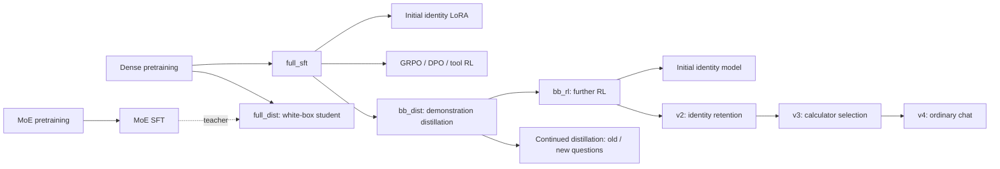

# MiniMind: From Training from Scratch to Tool Use and Better Chat

[简体中文](README.md) | English

This is a small language model training and evaluation project built on [jingyaogong/minimind](https://github.com/jingyaogong/minimind). It starts with a randomly initialized dense model of approximately **64M parameters**, then explores identity adaptation, reinforcement learning, preference optimization, mixture-of-experts architectures, and knowledge distillation. The models are also available in a local web demo, with subsequent work improving calculator use and ordinary conversation.

The purpose is to establish what each change improves, what it costs, and how the evidence can be checked. This repository keeps code, data-processing methods, training logs, individual responses, review decisions, and reports, including unsuccessful experiments and corrections to evaluation. The architecture and original trainers come from upstream; the experiment design, supporting code, and demo extensions are recorded here.

Updated through **October 28, 2026**. The latest version to pass the project's acceptance checks is **MiniMind-YuyangLU-v4**. The local demo retains eight models for comparison. v4 improves on its predecessor in the tested conversations, but still makes substantial errors and omissions; it is not a generally reliable assistant.

## Work in chronological order

The following sections follow the project's progression. Numbers can be compared within their stated protocols; **percentages from separate experiments do not form a single leaderboard**. Early math scores checked whether the final text contained the expected numbers. Later evaluations require complete, consistent answers. These metrics are identified separately below.

### 1. Set up the environment and measure local training speed — October 20

The initial environment used a Windows 11 laptop with an RTX 4070 Laptop 8GB GPU and 16GB RAM. Python, models, datasets, and caches were placed on the D drive. The recorded software includes Python 3.10 and PyTorch 2.6.0+cu126, with Streamlit for the demo.

Under the initial settings, local trial runs projected about five hours for one pretraining epoch and twelve hours for one supervised fine-tuning epoch. Early large training runs therefore moved to a cloud RTX 4090; most subsequent smaller experiments ran locally. See the [reproducibility notes](docs/REPRODUCIBILITY.en.md).

### 2. Complete pretraining and supervised fine-tuning — October 21

One epoch on each mini corpus produced `pretrain_768`, followed by supervised fine-tuning (SFT: learning from prompts and example responses) to obtain the baseline `full_sft_768`.

Cloud pretraining took approximately 54 minutes and SFT 94 minutes. The new [cloud_train.sh](cloud_train.sh) supported environment preparation, data downloads, staged training, background execution, checkpoint resumption, and optional shutdown on completion. Later experiments reused this launcher. Settings, logs, and training provenance are retained in the [historical experiment record, Chinese](my_eval/README.md).

### 3. Adapt identity with LoRA and check leakage into unrelated responses — October 21

LoRA updated approximately 0.39M additional parameters to associate identity questions with MiniMind and its local customizer, Yuyang LU. An initial 91-example identity dataset was followed by a mixture with ordinary conversations to reduce unwanted self-introductions.

In one early evaluation, identity-only training matched the expected name in 18/21 responses and leaked identity content into 4/20 unrelated responses. Mixed data gave 17/21 and 0/20. Another sample still showed leakage, illustrating variability in these small tests. Name matching also does not establish a complete, correct account of model provenance. Later v2 and v4 experiments revisited these issues. See the [historical record](my_eval/README.md).

### 4. Try GRPO and separate the sources of reward gains — October 21–22

Starting from SFT, two reward-driven runs completed 500 and 2,500 updates. Rewards combined a local reward-model score with formatting, length, and repetition terms. Generation length was reduced to fit cloud GPU memory.

On 30 chat questions with three samples each, the longer run increased total reward by **0.46 ± 0.13**, while the reward-model component increased only **0.11 ± 0.08**. Most of the gain came from formatting and length; a clear content improvement was not established. The shorter run also showed no clear benefit. The exact loss type used by the two cloud runs was not recorded, which remains a reproducibility limitation. See the [historical record](my_eval/README.md).

### 5. Train math tool use directly — October 22

Starting from `full_sft`, 1,500 updates on approximately 3,000 math tool-use examples produced `agent`. The model learned to select a calculator, supply expressions, and incorporate tool results into its answer.

Under the **legacy number-inclusion metric**, with 200 questions and two samples each, the score rose from **2.8% to 19.0%**. Single-expression tasks improved more than multi-expression tasks, and repeated calls became more common. This finding concerns this recipe and data, not reinforcement learning in general. Later overlap auditing corrected the main comparison set in step 14. See the [historical record](my_eval/README.md).

### 6. Try DPO preference optimization — October 22

Training used 16,866 preference pairs, with 300 held out for evaluation. Two versions compared the default learning rate with a tenfold increase. DPO trains the model to prefer the selected response in each pair.

Held-out preference accuracy was approximately **66% and 68%**, respectively. However, the higher-rate version reduced total chat reward by **0.22 ± 0.10**, producing longer and more repetitive answers. Better preference accuracy did not translate into better generation. See the [historical record](my_eval/README.md).

### 7. Compare MoE with the dense architecture — October 22

A four-expert MoE model selected one expert per token, with approximately **198.42M total** and **63.94M active** parameters. The active parameter count was similar to the dense model. Checks covered pretraining, SFT, held-out loss, chat, math, generation speed, and expert routing.

The recipe slightly reduced conversation prediction loss but worsened total chat reward. With the tested local implementation, generation ran at approximately **39 versus 62 tokens per second**, making MoE slower. Routing analysis observed token-type or domain preferences at different layers. These results did not establish the MoE model as a broadly better replacement. See the [historical record](my_eval/README.md).

### 8. Try white-box distillation from MoE to a dense student — October 22

The trained MoE served as a teacher. A dense student learned both the reference answers and the teacher's output probability distribution, starting from pretrained weights and using the same data and main settings as the SFT control.

The student became closer to the teacher's distribution. Historical held-out loss decreased by approximately **0.013 ± 0.007** relative to SFT, but total chat reward decreased by **0.20 ± 0.08**, and math tool performance did not improve. Matching the teacher's distribution did not guarantee better behavior. See the [historical record](my_eval/README.md).

### 9. Distill demonstrations from Qwen2.5-1.5B — October 23

A local teacher solved math tool tasks. The filtering rule in use at the time retained **2,514 trajectories**, which were mixed with **3,000 ordinary conversations**, for 5,514 examples. Two epochs from `full_sft`, approximately eight minutes and 690 updates, produced `bb_dist`.

Under the early **legacy metric**, using 200 questions and two samples each, math improved from **2.8% to 68.5%** without a clear chat reward change. The teacher scored 80.5% under a different, greedy, one-sample protocol. These settings do not support a direct claim that the student matched or exceeded the teacher. Retained demonstrations passed the filter used at that time; later auditing exposed its limitations. See the [historical record](my_eval/README.md).

### 10. Continue tool-use RL after distillation — October 23

A further 1,500 updates from `bb_dist` produced `bb_rl`. To fit the local 8GB GPU, the launcher avoided loading the large reward model; records show that this run never entered the branch requiring its score. Training took approximately 5.5 hours.

Legacy math scores increased from **68.5% to 81.8%**, with better expression arguments. Remaining errors included copying calculator results incorrectly into the final answer. Extra training and changed data were both involved, so the improvement could not be attributed entirely to RL. This motivated the controls in step 14. See the [historical record](my_eval/README.md).

### 11. Build the first demo and evaluation tools; diagnose format sensitivity — October 23

The SFT, MoE, math, and identity models were exported for the web demo and checked against their original outputs. A localhost launcher, model switching, and tool selection were added. Math, chat reward, answer loss, identity, speed, and data-rebuilding scripts were organized; ten early derived datasets were reconstructed and checked byte for byte.

Several important failures were retained:

- Merging an identity LoRA trained on `full_sft` directly into `bb_rl` reduced legacy math from **81.8% to 8.8%**. Retraining on the actual `bb_rl` base produced the first `bb_rl_id`, scoring 73.0%. Adapter training and merge bases must match.
- Changing tool descriptions and list structure reduced `bb_rl` to 54.5% under the old metric. Giving the initial identity model six tools reduced it to 30.2%. Several format, count, or wording factors changed together; these are not isolated causal effects of one factor.
- The completed portions of an initial tool probe exposed invented tool names, incorrect selections, and unnecessary calls. This was limited diagnostic work; not all planned combinations were evaluated.
- Identity adaptation worsened prediction loss even when shorter answers increased total chat reward. The metrics measured different things.

These findings motivated the later identity, tool, and chat repairs. See the [historical record](my_eval/README.md).

### 12. Compare with the official model and correct answer-loss measurement — October 24

The locally available official `minimind-3` was added to common evaluations and the demo. Conversion, vocabulary, template, and generation checks passed. Four of the original 300 language examples had no answer tokens after truncation, so the main loss comparison was corrected to the same **296 valid answers** across models, retaining the older results.

Official-model loss was **2.0927**, compared with **2.4583** for local SFT: a difference of **−0.366 ± 0.021**. The chat reward-model difference was only **+0.041 ± 0.116**, without a clear advantage. Lower loss supports better reference-answer prediction, not a blanket claim about chat quality. Upstream exposure to the public evaluation material is unknown. See the [official comparison, Chinese](my_eval/results/official_compare_20261024/REPORT.md).

### 13. Repair identity adaptation and release v2 — October 24–25

Identity LoRA was retrained on the actual `bb_rl` base, with revised identity and ordinary examples plus a constraint retaining the frozen original model's output distribution. Development-only selection chose `bb_rl_id_anchor4`, exported as **MiniMind-YuyangLU-v2**.

Compared with the previous identity model, name matches rose from **18/21 to 20/21** and answer loss on 296 examples fell from **2.6043 to 2.4964**, near the unpatched `bb_rl` value of 2.4888. Some responses still failed to explain the upstream-author/local-customizer relationship; 20 name matches are not 20 fully correct answers. See the [identity report, Chinese](my_eval/results/identity_repair_20261024/REPORT.md).

### 14. Add continued-distillation controls and audit train/test overlap — October 25

Two controls began from the same `bb_dist`: replaying old teacher questions or continuing distillation on new questions. Each used **8,003 examples and 1,002 updates**, matching row counts, updates, and expression-count distributions. Answer lengths differed, so supervised-token counts and compute were not matched.

Normalized-question auditing found three math test questions and one chat question with known exact training counterparts. Main comparisons moved to **197 math and 29 chat questions**, retaining original records. This does not rule out semantic overlap or unknown upstream exposure.

Continued supervised training also improved the math set, preventing attribution of all earlier gains to RL. Both new controls had answer loss around **2.541**, worse than the RL model's approximately **2.489**, and did not replace the main model as a general improvement. Their corrected math results appear in the next step. See the [control study, Chinese](my_eval/results/distill_control_20261025/REPORT.md).

### 15. Correct math grading and reassess rankings — October 26

The 1,600 stored responses from four models were rescored without retraining or generating new answers. The new grader requires completeness, correct association between values and questions, and consistent mathematical claims. Number substrings, omissions, mismatches, and contradictions cannot pass merely because the expected number appears. Uncertain formats receive individual review.

| Common protocol: 197 questions × 2 samples | Strict full-answer pass rate |
|---|---:|
| `bb_dist`: original distilled model | 57.61% |
| `bb_rl`: RL after distillation | 68.27% |
| `bb_sft_replay`: continued distillation on old questions | 70.05% |
| `bb_sft_new`: continued distillation on new questions | 72.84% |

The latter three clearly improve over the original distilled model, but all their pairwise 95% intervals include zero. **Their ordering is unresolved, and equivalence is not established.** This was a retrospective correction informed by historical outputs, not a newly preregistered blind test. See the [strict math report, Chinese](my_eval/results/strict_math_20261026/REPORT.md).

### 16. Add multiple candidates and reward-based selection — October 26

The demo gained best-of-2 and best-of-4 selection, off by default. Candidates are generated sequentially and scored by a local reward model, with generation and scoring using the GPU in separate stages. The selector receives neither reference answers nor calculator results. Only the selected trajectory enters chat history.

For v2, using the same four-candidate pool on 197 historical math questions, strict pass rates were **53.81%** for the first candidate, **65.99%** for best-of-2, and **70.56%** for best-of-4. Best-of-4 improved over the first by **16.75 ± 3.36 percentage points**, with a 95% interval of **[10.15, 23.35]**. Its additional advantage over best-of-2 remained uncertain.

Math generation and scoring time rose from approximately **1.45 to 7.26 seconds**, excluding full end-to-end web overhead. Mean content score on 29 chat questions rose from 0.483 to 0.690 out of 2, but review was not independent human blind evaluation. These findings concern v2 and do not automatically transfer to v3/v4. See the [best-of-N report, Chinese](my_eval/results/best_of_n_20261026/REPORT.md).

### 17. Retain a failed tool-selection attempt and its confirmation test — October 26

Training varied tool counts and descriptions and added ordinary questions requiring no call. Unnecessary calls decreased substantially, but the interval for improved complete calculator arguments included zero.

A fixed-size confirmation on new questions with the same frozen weights produced argument accuracy of **37.89% for the baseline and 33.33% for the candidate**, again failing the predefined standard. This round was **not released as a robust tool-selection improvement**. Weights, failed outputs, and diagnostics were retained. See the [first-round and confirmation report, Chinese](my_eval/results/tool_choice_20261026/REPORT.md).

### 18. Expand calculation intents and numerical counterexamples; release v3 — October 26

The second round added varied calculation requests, tool orders and descriptions, and requests to repeat numbers or copy expressions without evaluating them. A data-preparation confound between tool count and expression count was corrected. The selected `tool_choice2b_e3` was exported as **MiniMind-YuyangLU-v3**.

| New-question metric in the same experiment | v2 | v3 |
|---|---:|---:|
| Correct first-turn calculator and all expression arguments | 42.53% | 79.51% |
| Nonempty ordinary response without a tool call | 26.74% | 99.65% |
| Complete math flow: 48 questions, six tools, rewritten descriptions | 4.17% | 64.58% |

There were 48 base math questions and 24 base ordinary questions, each expanded across 12 conditions; statistics aggregate by base question. Evidence covers **calculator selection versus no call**, with other tools as distractors. The 99.65% no-call rate is not chat correctness.

The demo also gained a selected-tool allowlist and argument-type checks, with up to six tools enabled. Export, actual-model flow, and UI checks passed, and old models were retained. See the [second-round report, Chinese](my_eval/results/tool_choice_round2_20261026/REPORT.md).

### 19. Diagnose ordinary chat, train MiniMind itself, and release v4 — October 27

An initial 16-question development study examined tool descriptions, prompts, and existing models. Those exploratory flows were not shipped as formal demo features. The next experiment trained MiniMind itself from v3.

Training combined curated and corrected Qwen2.5-1.5B demonstrations, fixed writing/extraction/identity examples, math supervision, and retention of earlier outputs. Full-parameter chat repair was followed by identity LoRA on the exact selected base. The accepted `chat_repair_id_e3` became **MiniMind-YuyangLU-v4**. The teacher supplies training demonstrations and does not answer web-demo requests. Full-parameter training took approximately 5.5 minutes with 4.13GiB peak allocated GPU memory; identity refinement took approximately 2.5 minutes. These exclude the full preparation and evaluation time.

Formal chat evaluation used 48 base questions under three conditions, giving 144 responses per model, with thinking and best-of-N disabled.

| Metric in the same experiment | v3 | v4 |
|---|---:|---:|
| Mean content score, 0–2 | 0.389 | 0.924 |
| Main request receives a usable response, score 2 | 11.11% | 37.50% |
| Nonempty, complete response without a tool call | 83.33% | 98.61% |
| Historical strict math, 197 questions | 71.57% | 82.74% |
| Answer prediction loss, 296 examples, lower is better | 2.49630 | 2.52263 |
| Fully usable identity responses | 12/14 | 13/14 |

Usability improved by **26.39 ± 5.61 percentage points**, with a 95% interval of **[15.97, 37.50]**. Content improvement remained positive after excluding identity questions. Twelve predefined acceptance checks, export consistency, and actual Streamlit UI checks passed.

Limitations remain substantial: **62.50% of responses are not fully usable**, and explanations and short-message writing remain weak. Loss increased by **0.02633**, with a 95% interval of **[0.01221, 0.03823]**: a real deterioration within the predeclared allowance of 0.05. The improvement interval for another 48-question math regression set includes zero, so improvement there is unconfirmed. Content received individual model-assisted review; this was not independent human blind evaluation. See the [development diagnostics, Chinese](my_eval/results/chat_quality_20261027/README.md) and [chat-repair report, Chinese](my_eval/results/chat_repair_20261027/REPORT.md).

### 20. Archive completed experiments and publish bilingual documentation — October 28

Completed source code, logs, individual responses, review decisions, data audits, and reports were organized into this repository, with Chinese and English project overviews, a results guide, and reproducibility notes. Upstream licensing and original documentation were preserved, and hashes record the original experimental materials.

[SNAPSHOT_MANIFEST.json](SNAPSHOT_MANIFEST.json) records sizes and SHA256 hashes for **829 original files**. [verify_results.py](tools/verify_results.py) checks their hashes, strict math, best-of-N, recorded v3 acceptance, and v4 chat and retention statistics without a GPU or new generation. Model weights, training checkpoints, and large source corpora stay outside Git.

## Model relationships



The local demo retains `MiniMind-SFT`, `MiniMind-MoE`, `MiniMind-Math`, `MiniMind-YuyangLU`, `MiniMind-Official`, `MiniMind-YuyangLU-v2`, `MiniMind-YuyangLU-v3`, and `MiniMind-YuyangLU-v4`. The official model is a separately introduced comparison, not an ancestor of the locally trained models.

## Reading and running the project

| Location | Contents |
|---|---|
| `model/`, `trainer/` | Architecture, tokenizer, and original trainers |
| `scripts/` | Demo, tool execution, candidate selection, and export configuration |
| `dataset/` | Data-processing code and smaller derived/evaluation files |
| `my_eval/scripts/` | Training helpers, evaluation, grading, data auditing, and statistics |
| `my_eval/results/` | Fixed plans, individual outputs, model hashes, reviews, and reports |
| `my_eval/logs/` | Local logs and archived early cloud logs |
| `docs/` | Results guides and reproducibility notes |
| `tools/verify_results.py` | GPU-free result verification |

The [historical experiment record, Chinese](my_eval/README.md) retains earlier commands, metrics, and their evolution. Use the relevant individual reports for subsequent findings. The [reproducibility notes](docs/REPRODUCIBILITY.en.md) cover dependencies, model assets, and paths; an [English results guide](docs/RESULTS.en.md) is also available.

From the repository root, verify the saved key results:

```bash
python tools/verify_results.py
```

After restoring the corresponding weights and dependencies, use `start_demo.bat` or run:

```bash
python -m streamlit run scripts/web_demo.py --server.address 127.0.0.1 --server.port 8501
```

Select v4 in the demo; its default generation limit is 384 new tokens, and best-of-N is off by default. Model directories include configuration, vocabulary, and templates. **Weights must be restored separately; cloning the repository alone cannot run inference.** Historical launchers and some helpers retain D-drive paths, which need adjustment on another machine.

## Interpreting the evidence

- **The statistical unit is the base question.** Repeated samples and tool conditions are aggregated within questions before paired comparison. ± denotes one standard error; 95% intervals are shown separately. Intervals do not cover training-seed variation or reviewer uncertainty.
- **Metrics answer different questions.** Reward, prediction loss, tool routing, name matches, and content usability cannot substitute for each other. Acceptance means meeting specified thresholds, not preserving every capability unchanged.
- **Development and evaluation are separate.** Development data select candidates; configurations and weights are frozen before formal generation. Previously examined questions provide regression evidence. Removing known exact duplicates does not eliminate all semantic or upstream overlap.
- **Failures and reviews remain inspectable.** Content and uncertain math formats receive model-assisted review, with text and reasons preserved. This is not independent human blind evaluation or open-domain factual accuracy measurement.
- **Tool coverage is limited.** The principal validation concerns calculators versus no call. Some weather, exchange-rate, and other demo tools return mock data; reliable live-service integration was not established.

Upstream code uses Apache-2.0. The original [LICENSE](LICENSE), [Chinese upstream README](README.upstream.zh-CN.md), and [English upstream README](README_en.md) are retained. External models and datasets remain subject to their own source terms.
