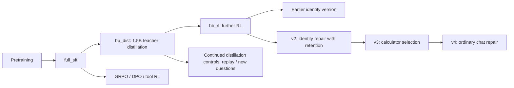

# MiniMind Training and Rigorous Evaluation Experiments

[简体中文](README.md) | English

A record of experiments built on [jingyaogong/minimind](https://github.com/jingyaogong/minimind): pretraining, supervised fine-tuning (SFT), LoRA, GRPO, DPO, mixture-of-experts (MoE), knowledge distillation, tool selection, and a local chat demo. **Yuyang LU** leads the project, with assistance from Claude Code and Codex for implementation, training, analysis, and review.

This repository archives completed work through **October 28, 2026**: source code, experiment reports, individual model responses, review decisions, and training logs. The model architecture and original trainers come from upstream MiniMind. Project-specific experiments are mainly in `my_eval/`; demo changes and supporting modules are in `scripts/`. Archived source and evidence retain their original bytes so recorded hashes can be checked.

## Findings supported by the recorded experiments

Each row below belongs to a separate evaluation protocol. **Do not rank models by comparing percentages across rows.** The linked reports specify question counts, seeds, tool conditions, generation settings, and limitations.

| Completed work | Results within that experiment | Scope and evidence |
|---|---|---|
| Continued-distillation controls and corrected math grading | Strict evaluation, 197 questions × 2 samples: original distilled model 57.61%; original RL model 68.27%; old-question replay 70.05%; new-question distillation 72.84% | Pairwise 95% intervals among the latter three include zero, so their ordering is unresolved. The earlier improvement cannot be attributed entirely to RL. [Report, Chinese](my_eval/results/strict_math_20261026/REPORT.md) |
| Reward-based selection among multiple candidates | For v2 on the same 197 questions: first candidate 53.81%; best-of-2 65.99%; best-of-4 70.56% | Best-of-4 gains 16.75 ± 3.36 percentage points over the first candidate; 95% interval [10.15, 23.35]. It also costs more generation and scoring time. [Report, Chinese](my_eval/results/best_of_n_20261026/REPORT.md) |
| Tool-selection repair, released as v3 | First-turn correctness of the calculator and all expression arguments: 42.53% → 79.51%. Nonempty ordinary responses without a tool call: 26.74% → 99.65% | The study covers calculator selection versus no call, with other tools as distractors. Avoiding calls does not establish content correctness. [Report, Chinese](my_eval/results/tool_choice_round2_20261026/REPORT.md) |
| Chat-quality repair of MiniMind itself, released as v4 | 48 questions × 3 conditions: mean content score 0.389 → 0.924 out of 2; fully usable responses 11.11% → 37.50% | Usability gains 26.39 ± 5.61 percentage points; 95% interval [15.97, 37.50]. Still, 62.50% of responses do not meet the fully usable standard. [Report, Chinese](my_eval/results/chat_repair_20261027/REPORT.md) |
| Retention checks in the v4 experiment | Historical strict math, 197 questions: 71.57% → 82.74%. Held-out answer prediction loss: 2.49630 → 2.52263 | Loss genuinely worsens, within the predefined allowance of 0.05. Fully usable identity responses increase from 12 to 13 out of 14. [Report, Chinese](my_eval/results/chat_repair_20261027/REPORT.md) |

Here, ± means **one paired standard error**, not a 95% confidence interval. Repeated samples or tool conditions are aggregated within each base question before comparing models. The intervals do not capture variation across training seeds or uncertainty in subjective review.

An [English results guide](docs/RESULTS.en.md) explains the completed experiments and their limitations in more detail. The original experiment reports and response records remain in their original languages.

## Earlier work assisted by Claude Code

The original handoff records the following stages. The [complete historical report, Chinese](my_eval/README.md) retains their results, including failures. Its older 200-question number-inclusion scores differ from the later strict answer-consistency metric; use the corrected results above when interpreting those comparisons.

- Cloud pretraining and SFT; training, speed, and routing comparisons between dense and MoE models.
- Identity LoRA and mixed training data; demonstrating that merging an adapter into a different base can severely damage existing capabilities.
- GRPO, calculator-based math RL, DPO, and a higher-learning-rate DPO control.
- White-box distillation from an MoE teacher, black-box distillation from Qwen2.5-1.5B, and RL after distillation.
- Rebuilding fixed data splits; math, language, identity, and reward-model evaluation; a local Streamlit demo and cloud training scripts.

Negative findings are retained: reward gains largely driven by formatting, higher DPO preference scores accompanied by worse generation, and no broad improvement from the tested MoE and white-box-distillation recipes.

These are stage-level attributions based on the handoff, not a claim that an original Git history establishes which AI tool wrote each line. See [credits and provenance](docs/CREDITS.en.md).

## Completed follow-up studies

| Study | Evidence |
|---|---|
| Comparison with the official model | [Official-model comparison, Chinese](my_eval/results/official_compare_20261024/REPORT.md) |
| Identity LoRA repair and v2 acceptance | [Identity study, Chinese](my_eval/results/identity_repair_20261024/REPORT.md) |
| Matched-training old-question and new-question distillation controls | [Control experiment, Chinese](my_eval/results/distill_control_20261025/REPORT.md) |
| Corrected math grading and uncertain rankings | [Strict math report, Chinese](my_eval/results/strict_math_20261026/REPORT.md) |
| Multiple candidates and reward-based selection | [Best-of-N report, Chinese](my_eval/results/best_of_n_20261026/REPORT.md) |
| Failed first tool-selection attempt and confirmation tests | [First-round report, Chinese](my_eval/results/tool_choice_20261026/REPORT.md) |
| Second tool-selection experiment and v3 | [Second-round report, Chinese](my_eval/results/tool_choice_round2_20261026/REPORT.md) |
| Chat training, identity retention, and v4 | [Chat-repair report, Chinese](my_eval/results/chat_repair_20261027/REPORT.md) |

## Model lineage



The MoE and white-box-distillation branches are omitted from this diagram. Their training provenance is preserved in the [technical archive, Chinese](my_eval/SUMMARY_FOR_CHATGPT.md).

## Repository layout

```text
model/                    Upstream MiniMind architecture and tokenizer
trainer/                  Upstream trainers
scripts/                  Demo, tools, candidate selection, export configuration
dataset/                  Data processing and smaller derived/evaluation files
my_eval/scripts/          Experiments, training helpers, grading, statistics
my_eval/results/          Per-response records, plans, hashes, decisions, reports
my_eval/logs/             Local logs; cloud/ archives earlier cloud training logs
docs/                     Provenance, results guides, reproducibility boundaries
tools/verify_results.py   GPU-free checks of key archived results
SNAPSHOT_MANIFEST.json    Original file hashes and local large-asset inventory
```

## Reading, verification, and running the demo

Start here and in the [English results guide](docs/RESULTS.en.md), then consult the individual reports. The [historical experiment record, Chinese](my_eval/README.md) documents how the metrics and conclusions evolved. [Reproducibility notes](docs/REPRODUCIBILITY.en.md) cover dependencies, weights, data, and what this snapshot can run.

Verify key results and archived file hashes without a GPU:

```bash
python tools/verify_results.py
```

The demo entry points are `start_demo.bat` and `scripts/web_demo.py`. After supplying the corresponding model weights, run it locally with:

```bash
python -m streamlit run scripts/web_demo.py --server.address 127.0.0.1 --server.port 8501
```

Configuration, tokenizers, templates, and export-validation records are included. Model weights, training checkpoints, token caches, and large source corpora stay outside Git. Historical launchers and some experiment helpers retain the original D-drive Python and model paths; adjust these when moving to another machine. Weights must be restored before inference can run: this repository is a code-and-evidence snapshot rather than a ready-to-load model distribution.

## Evaluation boundaries

- A correct number appearing somewhere in a response is insufficient. The answer must be complete, correctly associated with the request, and free of contradictions.
- Known exact training/test overlaps are excluded from the main comparisons while original records are retained. This does not establish the absence of upstream or semantic overlap.
- Reward scores, prediction loss, routing decisions, and response content are reported separately; none substitutes for all the others.
- Development data are used for selection; configuration and weight hashes are fixed before formal evaluation. Historical regression questions are not described as a new blind test.
- Content and uncertain mathematical formats are reviewed individually by an assistant, with reasons retained. This is not independent human blind evaluation or open-domain factual accuracy testing.
- Some demo tools, including weather and exchange-rate examples, return mock data. The completed studies do not establish reliable live-service integration.

The upstream code is provided under Apache-2.0. The original [LICENSE](LICENSE), [Chinese upstream README](README.upstream.zh-CN.md), and [English upstream README](README_en.md) are retained. External models and datasets have their own source terms.
