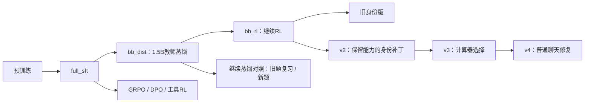

# MiniMind 训练与严谨评测实验

简体中文 | [English](README.en.md)

基于 [jingyaogong/minimind](https://github.com/jingyaogong/minimind)，记录从预训练、SFT、LoRA、GRPO、DPO、MoE，到知识蒸馏、工具选择和本地聊天演示的实验过程。项目由 **Yuyang LU** 主导，Claude Code 和 Codex 协助实现、训练、分析与复核。

这里保存截至 **2026-10-28** 已完成工作的代码、实验报告、逐题输出、裁决与训练日志。模型主体和原始训练器来自上游；本项目的实验工作主要位于 `my_eval/`，网页改动及支持模块位于 `scripts/`。源码与实验记录按原始字节保存，便于检查冻结摘要。

## 已有证据支持的结果

下表中的每一行都是一个独立实验协议，**不能跨行直接排模型名次**。百分比、问题数量、随机种子、工具条件和局限均可在对应报告中核对。

| 完成的工作 | 本次实验中的结果 | 解释范围与报告 |
|---|---|---|
| 补充继续蒸馏对照，并修正数学判分 | 严格197题×2次：原蒸馏57.61%，原RL68.27%，复习组70.05%，新题组72.84% | 后三者的配对95%区间包含0，暂不能确定先后；不把全部提升归因于RL。[修正报告](my_eval/results/strict_math_20261026/REPORT.md) |
| 多候选奖励挑选 | v2在同一批197题上：取第一个53.81%，2选1为65.99%，4选1为70.56% | 4选1比单次高16.75±3.36个百分点；95%区间[10.15,23.35]，同时增加生成与评分成本。[实验报告](my_eval/results/best_of_n_20261026/REPORT.md) |
| 工具选择修复，发布v3 | 数学首轮完整参数正确率42.53%→79.51%；普通题非空且不调用26.74%→99.65% | 只验证计算器与不调用，其他工具作为干扰项；不调用不代表内容正确。[实验报告](my_eval/results/tool_choice_round2_20261026/REPORT.md) |
| MiniMind本体聊天修复，发布v4 | 48题×3条件：内容分0.389→0.924/2；2分可用率11.11%→37.50% | 可用率提升26.39±5.61个百分点，95%区间[15.97,37.50]；仍有62.50%未达完全可用。[实验报告](my_eval/results/chat_repair_20261027/REPORT.md) |
| v4的能力保留检查 | 同轮历史严格数学197题71.57%→82.74%；回答预测损失2.49630→2.52263 | 损失有真实恶化，但处于事前允许的0.05范围内；14次身份回答完整可用数12→13。[实验报告](my_eval/results/chat_repair_20261027/REPORT.md) |

±表示按基础题配对的 **1个标准误**，不是95%置信区间。同题多次采样或多个工具条件先在题内聚合，不能当成互相独立的问题。统计区间未覆盖训练种子与主观裁决的不确定性。

## Claude Code 协助完成的早期工作

原交接记录覆盖以下阶段；完整历史报告与失败记录保留在 [my_eval/README.md](my_eval/README.md)。历史表格中的200题数字包含率与后来的严格回答一致性指标不同，应优先阅读上表和修正报告。

- 云端预训练与SFT；稠密模型与MoE的训练、速度及路由比较。
- 身份LoRA及混合数据；验证跨基座合并身份补丁会严重破坏原能力。
- GRPO、数学工具调用RL、DPO及较高学习率DPO的对照。
- MoE教师的白盒蒸馏、Qwen2.5-1.5B教师的黑盒蒸馏，以及蒸馏后的RL。
- 固定划分的数据重建、数学/语言/身份/奖励模型评测、Streamlit本地演示和云端训练脚本。

这些实验也包含负面结果：奖励上升主要来自格式、DPO偏好指标较高但生成更差、MoE和白盒蒸馏没有带来全面提升。它们是项目结论的一部分。

阶段来源依据原交接报告，不代表存在可逐行归属到某个AI工具的原始Git提交历史。见 [工作来源与上游致谢](docs/CREDITS.md)。

## 后续完成的检查与改进

| 工作 | 证据入口 |
|---|---|
| 与官方模型比较 | [官方对照报告](my_eval/results/official_compare_20261024/REPORT.md) |
| 身份LoRA重做与v2验收 | [身份实验报告](my_eval/results/identity_repair_20261024/REPORT.md) |
| 同训练量的新题/旧题蒸馏对照 | [对照实验报告](my_eval/results/distill_control_20261025/REPORT.md) |
| 数学判分修正和不确定名次 | [严格数学报告](my_eval/results/strict_math_20261026/REPORT.md) |
| 多候选生成与奖励挑选 | [多候选报告](my_eval/results/best_of_n_20261026/REPORT.md) |
| 工具选择首轮及独立复测的失败结论 | [首轮报告](my_eval/results/tool_choice_20261026/REPORT.md) |
| 工具选择第二轮与v3 | [第二轮报告](my_eval/results/tool_choice_round2_20261026/REPORT.md) |
| 普通聊天本体训练、身份保留与v4 | [聊天修复报告](my_eval/results/chat_repair_20261027/REPORT.md) |

## 模型关系



图中未展开MoE和白盒蒸馏分支，其训练来源见 [技术档案](my_eval/SUMMARY_FOR_CHATGPT.md)。

## 目录

```text
model/                    上游MiniMind结构与分词器
trainer/                  上游训练器
scripts/                  网页、工具、多候选和模型导出配置
dataset/                  数据处理代码和较小的派生/评测文件
my_eval/scripts/          实验、训练辅助、判分与统计代码
my_eval/results/          逐题结果、计划、摘要、裁决和报告
my_eval/logs/             本地日志；cloud/中保留早期云端训练日志
docs/                     来源、结论导读和复现边界
tools/verify_results.py   无需GPU的已发布关键结果核查
SNAPSHOT_MANIFEST.json    原始文件摘要与本地大文件清单
```

## 阅读、核查与运行

建议先阅读本页，再阅读相应单项报告；[完整实验记录](my_eval/README.md)保留历史数字和口径演变。[复现说明](docs/REPRODUCIBILITY.md)解释权重、数据、依赖与可运行范围。

不需要GPU即可核查本仓库关键结果与文件摘要：

```bash
python tools/verify_results.py
```

网页入口为 `start_demo.bat` / `scripts/web_demo.py`。准备好对应模型权重后，本地运行：

```bash
python -m streamlit run scripts/web_demo.py --server.address 127.0.0.1 --server.port 8501
```

仓库保留配置、分词器与导出验证记录；模型权重、训练检查点、词元缓存及大型原始语料不进入Git。原环境的启动脚本使用D盘的Python解释器，实验辅助脚本也保留原环境路径，换机时需要调整。下载或恢复权重之后才能运行推理，不能把代码快照当成开箱即用的模型分发包。

## 评测边界

- 数字出现在回答中，不足以判为正确；需完整作答、对应正确且没有矛盾。
- 已知训练同文污染从主要比较中排除，原始结果保留；未证明排除了所有上游或语义重合。
- 奖励模型分、预测损失、工具路由和回答内容分别报告，不能互相替代。
- 开发集用于选择候选，正式评测前固定配置与权重摘要。历史回归题不称为全新盲测。
- 内容与不确定数学格式由助手逐条复核，保存理由；不是独立人工盲评或开放领域事实准确率。
- 天气、汇率等部分网页工具提供演示返回，当前成果不包含实时服务可靠性验证。

上游按Apache-2.0许可提供；保留原 [LICENSE](LICENSE)、[上游中文说明](README.upstream.zh-CN.md)和 [上游英文说明](README_en.md)。外部数据和教师模型需分别遵循其来源条款。
