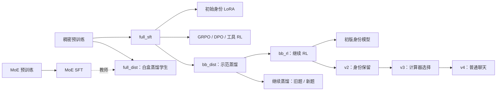

# MiniMind：从零训练到工具调用与聊天改进

[English](README.md) | 简体中文

这是一个基于 [jingyaogong/minimind](https://github.com/jingyaogong/minimind) 的小语言模型训练与评测项目。项目从随机初始化开始训练约 **64M 参数**的稠密模型，随后依次尝试身份微调、强化学习、偏好优化、混合专家结构和知识蒸馏，再将模型做成本地网页助手，持续改善计算器调用与普通聊天。

项目的重点是通过可复查的实验，弄清楚每一步改变了什么、是否有效、付出了什么代价。这里保存代码、数据处理方法、训练日志、逐题回答、评分记录和实验报告，既记录通过验收的改进，也记录失败尝试与评测修正。模型结构和原始训练器来自上游，实验设计、辅助代码及网页扩展位于本仓库。

当前最新通过项目验收的版本为 **MiniMind-YuyangLU-v4**，本地网页保留 8 个模型供比较。v4 的聊天表现相对上一版有改善，但仍存在明显错误与遗漏，尚不是通用可靠助手。

## 按实施顺序记录的工作

下文按项目推进顺序排列。同一实验内的数字可以按其协议比较，**不同实验的百分比不能直接拼成总排名**。早期数学使用“最终文本包含正确数字”的旧判分，后期改为检查整段回答的完整性与一致性，两种指标分别标明。

### 1. 搭建环境，测试本地训练速度

在 Windows 11、RTX 4070 Laptop 8GB、16GB 内存的笔记本上配置训练环境，将 Python 环境、模型、数据和缓存放在 D 盘。原环境使用 Python 3.10、PyTorch 2.6.0+cu126；网页使用 Streamlit。

完成预训练与监督微调的本地试跑：当时配置下，预训练一轮约需 5 小时，监督微调一轮约需 12 小时。因此将早期大规模训练移到 RTX 4090 云端，后续较小的训练和评测主要在本地进行。硬件与依赖见[复现说明](docs/REPRODUCIBILITY.md)。

### 2. 完成预训练和监督微调

使用 mini 语料各训练一轮，先得到 `pretrain_768`，再进行监督微调（SFT，即学习问题与示范回答），得到后续实验的基础模型 `full_sft_768`。

云端预训练约 54 分钟，SFT 约 94 分钟。同时建立 [cloud_train.sh](cloud_train.sh)，支持环境准备、下载数据、分阶段训练、后台运行、断点续训和可选的结束后关机。后续实验沿用这套启动流程；具体参数、日志和训练来源保留在[历史实验记录](my_eval/README.md)。

### 3. 用 LoRA 定制身份，并检查无关回答中的身份泄漏

使用 LoRA，只训练约 0.39M 个附加参数，让模型在身份问题中识别 MiniMind 与本地定制者 Yuyang LU。先用 91 条身份数据训练，再混入普通对话，观察模型是否在无关问题中也反复自我介绍。

早期一次测试中，单独身份训练的名字命中为 18/21，无关回答出现身份内容为 4/20；混合数据后为 17/21 和 0/20。另一次采样仍出现泄漏，说明这种小样本指标会波动。名字命中也不等于完整身份关系回答正确。这一阶段暴露的问题，随后在 v2 和 v4 中继续修复。见[历史实验记录](my_eval/README.md)。

### 4. 尝试 GRPO，并拆开看奖励的来源

从 SFT 模型出发，分别完成 500 步和 2,500 步的奖励驱动训练。奖励由本地奖励模型分和格式、长度、重复等项组成；降低生成长度以适配云端显存。

30 道聊天题、每题 3 次的比较中，较长训练的总奖励提高 **0.46 ± 0.13**，奖励模型分本身仅提高 **0.11 ± 0.08**。改善主要来自格式与长度，未证明回答内容明显变好。较短训练也没有测出明确收益。两次云端运行的具体损失类型未记录，因此保留这一复现限制。见[历史实验记录](my_eval/README.md)。

### 5. 直接训练数学工具调用

从 `full_sft` 开始，在约 3,000 道数学工具题上训练 1,500 步，得到 `agent`。模型学习选择计算器、传入算式并将结果写回回答。

在当时 200 题 × 2 次的**旧数字包含判分**下，成绩从 **2.8% → 19.0%**。单算式题改善较多，多算式题仍弱，并出现更多重复调用。这是该数据和训练配方下的结果，不代表强化学习普遍无效。后续还发现旧划分存在同文题，主要比较在第 14 项统一修正。见[历史实验记录](my_eval/README.md)。

### 6. 尝试 DPO 偏好优化

用 16,866 对偏好数据训练，留出 300 对评测，并比较默认学习率和 10 倍学习率两个版本。DPO 训练模型偏向一对回答中被选中的那个。

两个版本的留出偏好准确率约为 **66% 和 68%**，但更高学习率版本的聊天总奖励反而下降 **0.22 ± 0.10**，回答更长、重复更多。偏好指标提高并没有转化为更好的实际生成。见[历史实验记录](my_eval/README.md)。

### 7. 比较 MoE 与稠密结构

训练 4 专家、每个词元选 1 个专家的 MoE 模型：总参数约 **198.42M**，每次激活约 **63.94M**，与稠密模型的激活规模接近。完成预训练、SFT、留出损失、聊天、数学、生成速度及专家路由分析。

该配方的对话预测损失略低，但聊天总奖励更差；在当时本地实现下，生成速度约 **39 对 62 词元/秒**，MoE 更慢。路由检查观察到不同层按词元类型或领域分配专家。结果没有支持把该 MoE 版本作为全面更好的替代品。见[历史实验记录](my_eval/README.md)。

### 8. 尝试 MoE 到稠密模型的白盒蒸馏

用已训练的 MoE 作教师，让稠密学生同时学习示范答案和教师的输出概率分布。学生从预训练权重开始，与普通 SFT 使用相同数据和主要训练设置。

学生输出更接近教师，历史留出损失相对 SFT 降低约 **0.013 ± 0.007**，但聊天总奖励下降 **0.20 ± 0.08**，数学工具表现也没有改善。接近教师的分布并不保证学到更好的实际行为。见[历史实验记录](my_eval/README.md)。

### 9. 用 Qwen2.5-1.5B 生成示范，进行黑盒蒸馏

让本地教师执行数学工具任务，按当时的筛选规则保留 **2,514 条**轨迹，再混入 **3,000 条**普通对话，共 5,514 条。学生从 `full_sft` 出发训练两轮，约 8 分钟、690 步，得到 `bb_dist`。

在早期 200 题 × 2 次的**旧判分**下，数学成绩从 **2.8% → 68.5%**，聊天奖励没有清楚变化。教师在另一个贪心、每题一次的设置中为 80.5%；由于采样协议不同，不能据此宣称学生接近或超过教师。示范也只是通过了当时的筛选，后续严格审计揭示了该筛选的局限。见[历史实验记录](my_eval/README.md)。

### 10. 蒸馏后继续进行工具调用 RL

从 `bb_dist` 出发，完成 1,500 步训练，得到 `bb_rl`。为适配本地 8GB 显存，启动器不加载大体积奖励模型；记录显示该次训练未进入需要它评分的分支。训练约 5.5 小时。

旧数学判分从 **68.5% → 81.8%**，算式传参也有改善；剩余错误包含把计算器结果抄错到最终答案。由于额外训练量和数据同时变化，这一步不能单独证明 RL 是全部收益的原因，因此后来增加了第 14 项的控制组。见[历史实验记录](my_eval/README.md)。

### 11. 建立首版网页、模型导出和统一评测，定位格式敏感问题

将 SFT、MoE、数学模型与身份模型导出为网页可用格式，核对导出前后输出；增加只监听本机的启动入口、模型切换和工具选择。整理数学、聊天奖励、回答预测损失、身份、速度与数据重建脚本，10 个早期派生数据文件完成逐字节重建核对。

这一阶段保留了几个重要失败结果：

- 将在 `full_sft` 上训练的身份 LoRA 直接合并到 `bb_rl`，旧数学分从 **81.8% 降至 8.8%**；改在实际 `bb_rl` 基座上训练后，得到初版 `bb_rl_id`，旧数学分为 73.0%。LoRA 必须核对实际训练与合并基座。
- 更换工具说明及列表结构后，`bb_rl` 的旧数学分降至 54.5%；给初版身份模型同时提供 6 个工具时，旧数学分降至 30.2%。这些改动同时涉及格式、数量或措辞，不能只归因于一个因素。
- 已完成的首轮工具探测发现编造工具名、选错工具和普通问题乱调用；它是有限诊断，未完成全部原定组合。
- 身份模型的预测损失恶化，聊天总奖励却可能因回答变短而上涨，说明不同指标不能互相替代。

这为后续身份、工具和聊天修复提供了依据。见[历史实验记录](my_eval/README.md)。

### 12. 与官方模型比较，修正回答损失的计算

将本地已有的官方 `minimind-3` 纳入共同评测和网页，验证格式转换、词表、模板与生成一致性。发现旧 300 条语言评测中有 4 条回答被截断到没有有效词元，因此主要损失比较改用共同的 **296 条**有效回答，旧结果仍保留。

官方回答预测损失为 **2.0927**，本地 SFT 为 **2.4583**，差值 **−0.366 ± 0.021**；聊天奖励模型分差仅 **+0.041 ± 0.116**，没有测出明确优势。较低损失支持较好的参考回答预测，不能直接解释成聊天全面更好。官方是否在上游训练中见过公开评测材料不确定。见[官方对照报告](my_eval/results/official_compare_20261024/REPORT.md)。

### 13. 修复身份补丁，发布 v2

从实际 `bb_rl` 基座重新训练身份 LoRA，调整身份与普通数据，并加入冻结原模型的输出保留约束。仅在开发集选择候选，最终接受 `bb_rl_id_anchor4`，导出为 **MiniMind-YuyangLU-v2**。

相对旧身份版，名字命中 **18/21 → 20/21**，296 条回答损失 **2.6043 → 2.4964**，接近未加补丁的 `bb_rl` 的 2.4888。但部分回答仍没有解释上游作者与本地定制者的关系，不能把 20 次名字命中写成 20 次完整正确。见[身份修复报告](my_eval/results/identity_repair_20261024/REPORT.md)。

### 14. 补充继续蒸馏对照，审计训练与测试重合

从同一个 `bb_dist` 出发，训练“旧题复习”和“新题继续蒸馏”两个控制组，每组 **8,003 条、1,002 次更新**，匹配样本数、更新步数与算式数量分布。回答长度不同，因此不是相同监督词元数或计算量的对照。

按规范化用户问题审计，发现 3 道数学测试题及 1 道聊天测试题有已知训练同文副本；主要比较统一改为 **197 道数学题、29 道聊天题**。旧结果保留，不能声称排除了全部语义重合或未知上游接触。

继续监督训练也能改善这批数学题，说明原提升不能全部归于 RL。两个新控制组的回答损失约 **2.541**，比原 RL 的约 **2.489** 更差，未成为全面替代主线的版本。其最新数学结论由下一项严格重评给出。见[对照实验报告](my_eval/results/distill_control_20261025/REPORT.md)。

### 15. 修正数学判分，重新评估名次

对 4 个模型已保存的 1,600 次回答重新评分，不重新训练或生成。新规则要求回答完整、数值与题目对应、算式和结论一致；数字子串、漏答、错配和矛盾都不能因出现正确数字而通过。不确定格式逐条复核。

| 同一协议：197 题 × 2 次 | 严格完整回答通过率 |
|---|---:|
| `bb_dist`：原蒸馏 | 57.61% |
| `bb_rl`：蒸馏后 RL | 68.27% |
| `bb_sft_replay`：旧题继续蒸馏 | 70.05% |
| `bb_sft_new`：新题继续蒸馏 | 72.84% |

后三者相对原蒸馏有清楚改善，但彼此差异的配对 95% 区间均包含 0，**暂不能可靠排出先后，也没有证明等效**。这是基于历史输出的回溯修正，不是一次新的事前盲测。见[严格数学报告](my_eval/results/strict_math_20261026/REPORT.md)。

### 16. 实现多候选生成与奖励挑选

网页新增 2 选 1 和 4 选 1，默认关闭。候选依次生成，再用本地奖励模型评分，生成模型与奖励模型分阶段使用 GPU。选择器不接收标准答案或计算器结果，只将选中的轨迹写入聊天历史。

在 v2 的同一个四候选池、197 道历史数学题上，单次 **53.81%**、2 选 1 **65.99%**、4 选 1 **70.56%**。4 选 1 相对单次提高 **16.75 ± 3.36 个百分点**，95% 区间 **[10.15, 23.35]**；相对 2 选 1 的额外收益仍不确定。

数学生成与评分时间约 **1.45 秒 → 7.26 秒**，不包含完整网页端到端开销。29 道聊天题的内容均分从 0.483 提高到 0.690/2，但评分并非独立人工盲评。这些结果针对 v2，不能自动推广到 v3/v4。见[多候选报告](my_eval/results/best_of_n_20261026/REPORT.md)。

### 17. 首轮工具选择训练与独立确认未通过

增加不同工具数量、说明和无需调用的普通问题，训练计算器选择与参数传递。首轮普通问题乱调用明显减少，但完整参数正确率的改善区间包含 0。

随后对同一冻结权重做固定规模的新题确认，参数正确率为基线 **37.89%**、候选 **33.33%**，仍未达到预设标准。因此该轮**没有作为稳健工具选择版本发布**，权重、失败输出与诊断全部保留。见[首轮及确认报告](my_eval/results/tool_choice_20261026/REPORT.md)。

### 18. 扩充计算意图和数字反例，发布 v3

第二轮增加多种计算问法、工具顺序与说明变化，以及“复述数字、复制算式但不计算”的反例；修正准备数据中工具数量与算式数量绑定的问题。选中 `tool_choice2b_e3`，导出为 **MiniMind-YuyangLU-v3**。

| 同轮新题指标 | v2 | v3 |
|---|---:|---:|
| 数学首轮计算器及全部算式参数正确 | 42.53% | 79.51% |
| 普通题非空且不调用工具 | 26.74% | 99.65% |
| 6 工具、改写说明下的 48 题完整数学通过率 | 4.17% | 64.58% |

基础题为数学 48 道、普通 24 道，各展开 12 种工具条件，统计先按基础题聚合。验证范围是**计算器与不调用**，其他工具作为干扰项；99.65% 不调用率不是聊天正确率。

网页同时增加工具白名单和参数类型检查，最多选择 6 个工具。导出、实际模型流程与界面检查通过，旧模型保留。见[第二轮报告](my_eval/results/tool_choice_round2_20261026/REPORT.md)。

### 19. 诊断普通聊天，训练模型本体并发布 v4

先用 16 道开发题检查工具说明、提示词与已有模型对普通回答的影响；这些探索性流程没有作为正式功能接入网页。随后从 v3 训练 MiniMind 本身。

训练使用经过筛选和修正的 Qwen2.5-1.5B 示范、固定写作/提取/身份样例，以及数学监督和旧输出保留数据。完成全参数聊天修复，再在实际选中的基座上训练身份 LoRA，接受 `chat_repair_id_e3` 并导出为 **MiniMind-YuyangLU-v4**。教师只提供训练示范，不参与网页回答。全参数训练约 5.5 分钟、峰值分配显存 4.13GiB，身份补充约 2.5 分钟；这些数字不包含全部数据准备与评测时间。

正式聊天评测为 48 道基础题，每题 3 种条件，每模型 144 次回答；关闭思考与多候选。

| 同轮指标 | v3 | v4 |
|---|---:|---:|
| 内容平均分，0–2 分 | 0.389 | 0.924 |
| 主要请求得到可用回应，2 分 | 11.11% | 37.50% |
| 非空、完整且不调用工具 | 83.33% | 98.61% |
| 历史严格数学，197 题 | 71.57% | 82.74% |
| 回答预测损失，296 条，低为好 | 2.49630 | 2.52263 |
| 身份内容完整可用 | 12/14 | 13/14 |

可用率提高 **26.39 ± 5.61 个百分点**，95% 区间 **[15.97, 37.50]**；排除身份题后仍有内容改善。12 项预设验收、导出一致性及真实 Streamlit 界面检查通过。

局限同样明确：**62.50% 的回答仍未完全可用**，知识解释和短消息写作仍弱；损失增加 **0.02633**，95% 区间 **[0.01221, 0.03823]**，确有恶化，只是处于事前允许的 0.05 范围内。另一个 48 题数学回归检查的提升区间包含 0，不能确认该组也改善。内容采用模型辅助的逐条评分，未经过独立人工盲评。见[开发诊断](my_eval/results/chat_quality_20261027/README.md)和[聊天修复报告](my_eval/results/chat_repair_20261027/REPORT.md)。

### 20. 整理实验档案，发布中英文项目说明

将完成工作的源码、日志、逐题回答、裁决、数据审计和报告整理到本仓库，编写中英文项目说明、结果导读和复现说明。保留上游许可证及原说明，并用文件摘要记录原始实验材料。

[SNAPSHOT_MANIFEST.json](SNAPSHOT_MANIFEST.json) 包含 **829 个原始文件**的大小与 SHA256。[verify_results.py](tools/verify_results.py) 可以在不使用 GPU、不重新生成回答的情况下核对文件摘要、严格数学、多候选结果、v3 验收记录及 v4 聊天和能力保留统计。模型权重、训练检查点和大型源语料不进入 Git。

## 模型之间的关系



本地网页保留 `MiniMind-SFT`、`MiniMind-MoE`、`MiniMind-Math`、`MiniMind-YuyangLU`、`MiniMind-Official`、`MiniMind-YuyangLU-v2`、`MiniMind-YuyangLU-v3` 和 `MiniMind-YuyangLU-v4`。官方模型是另行引入的对照，不是本地训练链条的父模型。

## 如何阅读和运行

| 位置 | 内容 |
|---|---|
| `model/`、`trainer/` | 模型结构、分词器与原始训练器 |
| `scripts/` | 网页、工具执行、多候选挑选和模型导出配置 |
| `dataset/` | 数据处理代码及较小的派生、评测文件 |
| `my_eval/scripts/` | 训练辅助、评测、判分、数据审计与统计脚本 |
| `my_eval/results/` | 固定方案、逐题输出、模型摘要、裁决和实验报告 |
| `my_eval/logs/` | 本地日志及归档的早期云端日志 |
| `docs/` | 结果导读与复现说明 |
| `tools/verify_results.py` | 不依赖 GPU 的结果核查 |

[历史实验记录](my_eval/README.md)保留早期命令、旧指标和口径演变；解释后续结果时，应以对应单项报告为准。[复现说明](docs/REPRODUCIBILITY.md)介绍依赖、模型资产及路径要求，也提供[英文结果导读](docs/RESULTS.en.md)。

在仓库根目录核查已保存的关键结果：

```bash
python tools/verify_results.py
```

准备对应模型权重与依赖后，使用 `start_demo.bat`，或运行：

```bash
python -m streamlit run scripts/web_demo.py --server.address 127.0.0.1 --server.port 8501
```

网页可选择 v4；其默认生成上限为 384 个新词元，多候选默认关闭。模型目录包含配置、词表和模板，**权重需要另行恢复，克隆仓库本身不能直接运行模型**。原启动脚本和部分辅助代码保留 D 盘路径，换机时需调整。

## 结果应如何理解

- **统计单位是基础题。** 同一题的多次采样或工具条件先聚合，再做配对比较。文中的 ± 表示 1 个标准误，95% 区间另列；区间未覆盖训练种子变化和评分者不确定性。
- **各指标分别回答不同问题。** 奖励、预测损失、工具路由、名字命中和内容可用率不能互相替代。通过项目验收表示满足指定门槛，不表示所有能力都不变。
- **开发和验收分开。** 开发集选版本，正式生成前冻结配置与权重；已看过的历史题只作回归证据。去掉已知同文题不保证排除了所有语义或上游数据重合。
- **保留失败和裁决。** 内容与不确定数学格式采用模型辅助复核，原文与理由可查；不是独立人工盲评，也不是开放领域事实准确率。
- **工具能力范围有限。** 主要验证计算器选择与不调用；天气、汇率等部分工具返回演示数据，没有验证实时服务可靠性。

上游代码采用 Apache-2.0 许可，原 [LICENSE](LICENSE)、[上游中文说明](README.upstream.zh-CN.md)与[上游英文说明](README_en.md)保留。外部模型与数据集分别遵循其来源条款。
